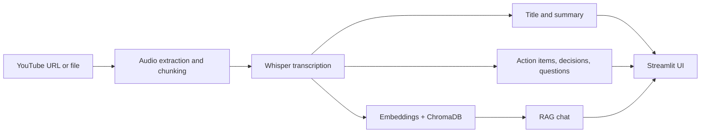

# 🎬 VideoGenius AI: Video Summarizer & Meeting Assistant

Turn any YouTube video, lecture or meeting recording into a **transcript, summary, action items, key decisions and open questions**, then **chat with the video** using Retrieval-Augmented Generation (RAG).


> 📸 **Screenshot:** add a screenshot of the dashboard here, for example `docs/dashboard.png`, then use ``.

---

## ✨ Features

- **Flexible input**: paste a YouTube link or upload an audio/video file (MP3, WAV, M4A, MP4, MOV, MKV and more).
- **Local transcription** with OpenAI Whisper, with support for **English and Hindi**.
- **AI-generated insights**:
  - Video title
  - Concise summary
  - Action items
  - Key decisions
  - Open questions
- **Chat with your video**: ask questions and get answers grounded in the transcript (RAG with ChromaDB and HuggingFace embeddings).
- **Modern Streamlit UI**: dashboard, personal library, analytics and settings.
- **Saved library**: every processed video is stored locally so you can reopen it later.
- **Export**: download the full report (Markdown) and the transcript (TXT).
- **CLI mode**: run the whole pipeline from the terminal with `main.py`.

---

## 🧠 How it works



1. **Ingest**: `yt-dlp` downloads audio from YouTube, or the uploaded file is converted with `pydub`/FFmpeg, then split into chunks.
2. **Transcribe**: each chunk is transcribed locally with Whisper (English or Hindi).
3. **Analyze**: LangChain chains call the LLM to produce the title, summary and structured insights.
4. **Index**: the transcript is split, embedded with HuggingFace sentence-transformers and stored in ChromaDB.
5. **Chat**: your questions retrieve the most relevant transcript passages and the LLM answers from them.

---

## 🛠️ Tech stack

| Layer | Tools |
|---|---|
| UI | Streamlit |
| Audio ingestion | yt-dlp, pydub, FFmpeg |
| Speech-to-text | OpenAI Whisper (local), PyTorch |
| Translation | Sarvam AI, deep-translator |
| LLM orchestration | LangChain (LCEL) |
| LLM providers | Mistral AI, OpenRouter (OpenAI-compatible) |
| Embeddings / RAG | sentence-transformers, ChromaDB |
| Export | fpdf2 |
| Config | python-dotenv |

---

## 📁 Project structure

```
video-agent/
├── app.py                  # Streamlit web UI
├── main.py                 # Command-line version of the pipeline
├── requirements.txt
├── .env                    # API keys (not committed)
│
├── core/
│   ├── transcriber.py      # Whisper transcription (transcribe_all)
│   ├── summarize.py        # Title + summary (generate_title, summarize)
│   ├── extractor.py        # Action items, decisions, open questions
│   └── rag_engine.py       # Vector store + Q&A (build_rag_chain, ask_question)
│
├── utils/
│   └── audio_processors.py # Download / convert / chunk audio (process_input)
│
├── data/                   # Saved library (history.json)
├── downloads/              # Temporary downloaded audio
└── vector_db/              # ChromaDB persistence
```

---

## 🚀 Getting started

### 1. Prerequisites

- **Python 3.10 or newer**
- **FFmpeg** installed and available on your `PATH` (required by Whisper, pydub and yt-dlp)
  - Windows: `winget install ffmpeg` (or `choco install ffmpeg`)
  - macOS: `brew install ffmpeg`
  - Ubuntu/Debian: `sudo apt install ffmpeg`
- API keys for the LLM and translation providers you use (see [Configuration](#-configuration))
- *(Optional)* An NVIDIA GPU makes Whisper much faster, but it also runs on CPU.

### 2. Clone the repository

```bash
git clone https://github.com/<your-username>/<your-repo>.git
cd <your-repo>
```

### 3. Create a virtual environment

**Windows (PowerShell)**

```powershell
python -m venv venv
.\venv\Scripts\Activate.ps1
```

**macOS / Linux**

```bash
python3 -m venv venv
source venv/bin/activate
```

### 4. Install dependencies

```bash
pip install -r requirements.txt
```

> The first run downloads the Whisper model and the embedding model, so it can take a few minutes.

---

## 🔑 Configuration

Create a `.env` file in the project root and add the keys your code uses:

```env
MISTRAL_API_KEY=your_mistral_key
OPENROUTER_API_KEY=your_openrouter_key
SARVAM_API_KEY=your_sarvam_key
```

> ⚠️ The variable names above are examples. Use the exact names your `core/` modules read with `os.getenv(...)`.
> **Never commit `.env`** (see [.gitignore](#-recommended-gitignore)).

### Optional: theme & upload size

Create `.streamlit/config.toml` to lock the light theme and allow larger uploads:

```toml
[theme]
base = "light"
primaryColor = "#76C0EC"
backgroundColor = "#FFF6DC"
secondaryBackgroundColor = "#FFFFFF"
textColor = "#425B9A"

[server]
maxUploadSize = 2048   # MB
```

---

## ▶️ Usage

### Web app (recommended)

```bash
streamlit run app.py
```

Then open the URL shown in the terminal (usually http://localhost:8501).

1. Go to **Settings** and choose the video language (English or Hindi).
2. On the **Dashboard**, upload a file or paste a video link.
3. Click **Generate Summary** and wait for the pipeline to finish.
4. Explore the **Summary**, **Insights**, **Transcript** and **Chat** tabs.
5. Find past videos anytime in **My Library**.

### Command line

```bash
python main.py
```

You will be asked for a YouTube URL or file path and the language (`english` / `hindi`). The results are printed in the terminal, followed by an interactive chat. Type `exit`, `quit` or `q` to stop.

---

## 🧩 Using the pipeline in your own code

```python
from main import run_pipeline

result = run_pipeline("https://www.youtube.com/watch?v=...", language="english")

print(result["title"])
print(result["summary"])
print(result["action_items"])
```

---

## 🙈 Recommended `.gitignore`

```gitignore
# Environment
venv/
.env

# Python
__pycache__/
*.pyc

# App data
downloads/
vector_db/
data/
```

---

## 🩺 Troubleshooting

| Problem | Fix |
|---|---|
| `ffmpeg not found` | Install FFmpeg and make sure it is on your `PATH`, then restart the terminal. |
| Text or inputs look dark / unreadable | Add the `.streamlit/config.toml` shown above and restart the app. |
| Upload fails for large files | Increase `maxUploadSize` in `.streamlit/config.toml`. |
| Transcription is very slow | Use a smaller Whisper model, or run on a machine with a CUDA GPU. |
| YouTube download fails | Update yt-dlp: `pip install -U yt-dlp`. |
| `ModuleNotFoundError` | Activate your virtual environment and re-run `pip install -r requirements.txt`. |
| API / authentication errors | Check the keys in `.env` and make sure the file is in the project root. |

---

## 🗺️ Roadmap

- [ ] Timestamped notes and clickable transcript segments
- [ ] Export summaries to PDF
- [ ] Speaker diarization for meetings
- [ ] More languages
- [ ] Docker support

---

## 🤝 Contributing

Contributions are welcome!

1. Fork the repository
2. Create a branch: `git checkout -b feature/my-feature`
3. Commit your changes: `git commit -m "Add my feature"`
4. Push the branch: `git push origin feature/my-feature`
5. Open a Pull Request

---

## 📄 License

Distributed under the MIT License. See `LICENSE` for details.
*(Add a `LICENSE` file to your repository, or replace this section with the license you prefer.)*

---

## 🙏 Acknowledgements

[OpenAI Whisper](https://github.com/openai/whisper) · [LangChain](https://www.langchain.com/) · [Streamlit](https://streamlit.io/) · [ChromaDB](https://www.trychroma.com/) · [yt-dlp](https://github.com/yt-dlp/yt-dlp) · [Sentence-Transformers](https://www.sbert.net/)